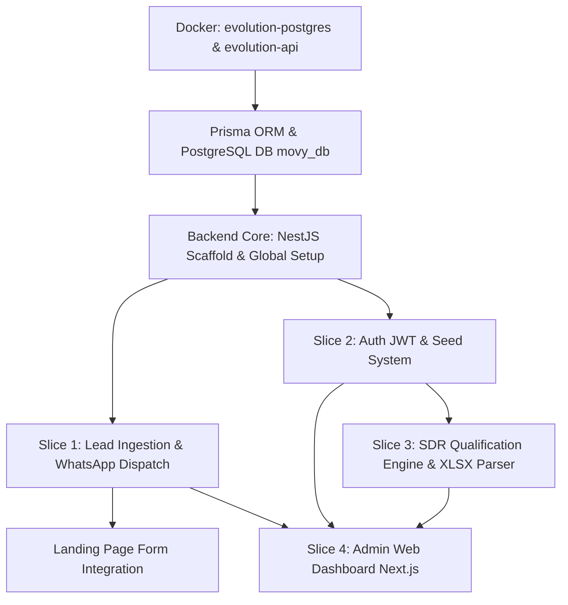

# Technical Implementation Plan: MOVY Lead Engine & SDR Platform

## Overview
Este plano descreve a estratégia de implementação para transformar a especificação formal (`SPEC.md`) em um produto funcional, estável e testável. A arquitetura divide o sistema em monorepo estruturado (`apps/backend` e `apps/frontend`), reaproveitando a infraestrutura do Docker já existente (`evolution-postgres` e `evolution-api`).

A abordagem segue **fatiamento vertical (Vertical Slicing)**: cada ciclo entrega uma fatia funcional completa e verificável de ponta a ponta, em vez de acumular camadas horizontais desconectadas.

---

## Component Architecture & Dependency Graph

---

## Implementation Order & Strategy

### Fase 1: Fundação & Infraestrutura (Slice 0)
- Provisionar banco `movy_db` no PostgreSQL via Docker existente.
- Configurar workspace backend NestJS com Prisma ORM e tipagens estritas.
- Criar migrations com o modelo completo de entidades (`User`, `Lead`, `LeadQualification`, `LeadFollowUp`).
- Provisionar frontend Next.js 14+ (App Router, Tailwind CSS, Lucide).

### Fase 2: Ingestão de Leads da Landing Page & WhatsApp (Slice 1)
- Endpoint público com validação estrita: `POST /api/leads/capture`.
- Persistência imediata com status `notificationStatus = PENDING`.
- Disparo assíncrono para Evolution API (`/message/sendText/bot%20movy` -> `120363413821500503@g.us`).
- Ajuste do formulário da `landing-page/script.js` para enviar requisições com feedback visual de carregamento, sucesso e erro.

### Fase 3: Autenticação & Usuários (Slice 2)
- Módulo de autenticação NestJS com Passport JWT, guards e cookies/Bearer token.
- Script de seed do Prisma para criar o usuário `admin@movy.com.br`.
- Tela de login no Next.js com validação e proteção de rotas privadas via middleware.

### Fase 4: Motor de Qualificação SDR & XLSX (Slice 3)
- Serviço isolado com regras de negócio puras (Test-Driven):
  - Cálculo de nota total (0 a 18).
  - Trava dos critérios mínimos para reunião com closer.
  - Classificação de Prioridade e Encaminhamento.
- Parser de arquivo `.xlsx` compatível com a planilha `MOVY-Qualificacao-SDR.xlsx`.
- Testes unitários cobrindo todos os cenários limites do Manual do SDR.

### Fase 5: Painel Web de Gestão & Ficha SDR (Slice 4)
- Dashboard Next.js autenticado:
  - Tabela de leads com filtros rápidos por status, prioridade e busca por nome/telefone.
  - Visão Kanban de etapas do funil com transição de status.
  - Ficha completa do Lead com Scorecard interativo (0 a 3 nos 6 critérios) e cálculo em tempo real.
  - Seção de registro de notas de follow-up e histórico comercial.

---

## Riscos Técnicos e Estratégias de Mitigação

| Risco Identificado | Impacto | Mitigação Técnica |
|---|---|---|
| **Oscilação / Queda da Evolution API** | Mensagens de lead não entregues no grupo do WhatsApp | Salvar o lead **sempre antes** no PostgreSQL. O envio para a Evolution API roda em background e atualiza `notificationStatus: SENT` ou `FAILED`. Criação de botão de reenvio manual no painel. |
| **Instância com espaço no nome (`bot movy`)** | Falha de URL HTTP na chamada da API | Utilizar sanitização de URI com `encodeURIComponent('bot movy')` gerando `bot%20movy`. |
| **Erros de preenchimento na planilha XLS** | Quebra do backend durante o parse | Validação defensiva do buffer de planilha: ignorar células corrompidas e aceitar preenchimentos parciais gravando como "Pendente". |
| **Vazamento de dados comerciais de leads** | Exposição pública da base de clientes | Endpoints de leads e métricas 100% protegidos por `JwtAuthGuard`. Apenas `POST /leads/capture` é público com rate-limiting. |

---

## Verification Checkpoints

1. **Checkpoint 1 (Banco & Infra):** `docker-compose` rodando com PostgreSQL acessível e migrations do Prisma executadas com sucesso.
2. **Checkpoint 2 (Capture E2E):** Preenchimento do formulário na landing page gera registro no banco e mensagem formatada no grupo do WhatsApp.
3. **Checkpoint 3 (Auth & Seed):** Login realizado com sucesso no frontend Next.js com as credenciais criadas pelo seed.
4. **Checkpoint 4 (Engine SDR Unit Tests):** 100% dos testes unitários das regras de qualificação passando (casos do manual: soma 17 com decisor 2 = não agendar; soma 14 com todos mínimos = agendar).
5. **Checkpoint 5 (Ficha & Gestão):** SDR consegue abrir um lead, pontuar os 6 critérios, visualizar encaminhamento automático e salvar com histórico de follow-up.
